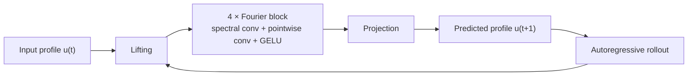
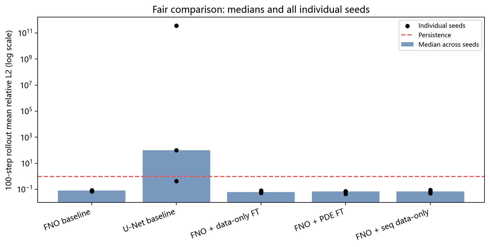
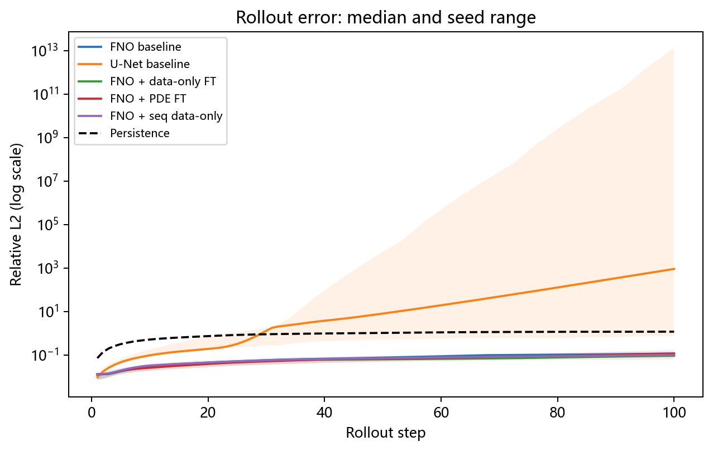
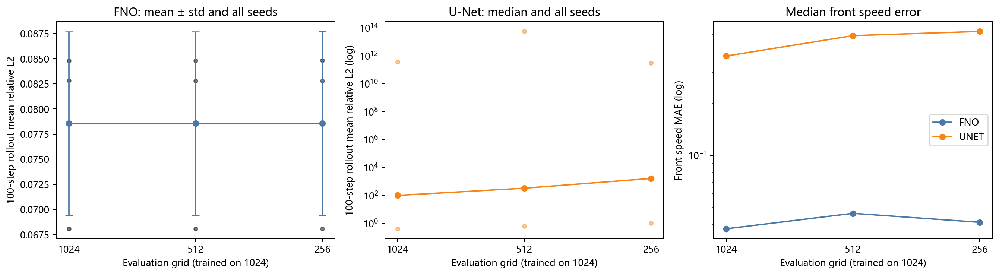
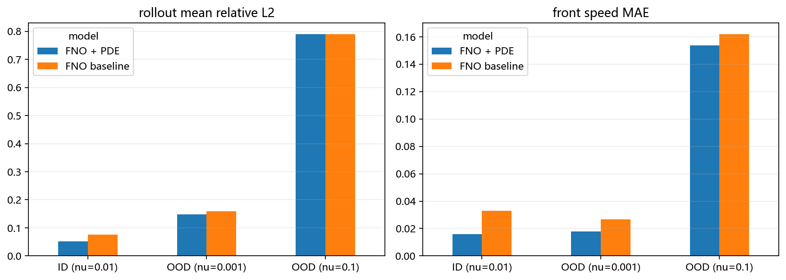

# pde-burgers-front


[](LICENSE)

**Neural operators for PDEBench 1D Burgers front prediction.**

> On 200 public Burgers trajectories, FNO1D reaches a mean 100-step rollout
> relative L2 error of 0.077 across three stable seeds; two added U-Net seeds
> diverge autoregressively. FNO error stays near 0.0786 when the evaluation grid
> changes from 1024 to 512 and 256. PDE and sequence fine-tuning are evaluated
> with paired seeds, and their benefits remain inconclusive.

This repository learns a PDE surrogate from **public** PDEBench data, with a
clear path from a supervised baseline to physics-informed fine-tuning. The
midterm report is complete, and the main FNO baseline uses three random seeds.

- [Chinese report (Markdown)](docs/report.md) · [PDF](docs/report.pdf) · [LaTeX source](docs/report.tex)
- [Dataset selection record](docs/data_check.md)
- [Experiment log](docs/experiment_log.md)
- [Reproducible baseline checkpoint](checkpoints/fno40_seed0/)

The data contains propagating viscous **shock fronts**:

\[
u_t + u u_x = \nu u_{xx}
\]

Strictly speaking, these are traveling shock/front solutions rather than a
single permanent periodic traveling wave.  The project uses the phrase
"front" deliberately.

---

## 1. Why this dataset

We checked PDEBench 1D ReactionDiffusion first.  Across six parameter
combinations (`Nu=0.5/1.0`, `Rho=1/2/5/10`), the field relaxes to a spatial
constant by the final time; there is no persistent front.  See
[`docs/data_check.md`](docs/data_check.md).

PDEBench **1D Burgers** is different: the `u(x,t)` heatmaps show diagonal
bands, i.e. propagating shocks/fronts.  That makes it suitable for a
"traveling front" project.

---

## 2. Quick start

```bash
python -m venv .venv
# Windows
.venv\Scripts\activate
pip install -r requirements.txt
# For the exact package versions used in the updated experiments:
# pip install -r requirements-lock.txt
```

### Download only 200 trajectories

The full PDEBench Burgers file is ~7.7 GB.  This script uses HTTP Range
requests to read only the first `N` trajectories and saves a small local
`.npz`:

```bash
python scripts/download_subset.py \
  --file-id 281363 \
  --n-samples 200 \
  --nu 0.01 \
  --out data/burgers_nu0.01_200.npz
```

The resulting file is roughly 140 MB (20 trajectories are about 14 MB).

### Smoke test

```bash
python scripts/smoke_test.py
python -m unittest discover -s tests -v
```

To reproduce the complete fair-comparison and resolution tables:

```bash
python scripts/reproduce_main.py
```

The script downloads missing data, runs any missing seed experiments, evaluates
Persistence and resolution generalization, and regenerates the main figures.
Existing metrics are reused by default; `--overwrite` forces a full rerun.
`make reproduce` is equivalent, while `make reproduce-minimal` runs only the
original single-baseline pipeline. The updated environment is Windows,
Python 3.14.4, PyTorch 2.11.0, CPU (AMD Ryzen 7 8845H).

### Train FNO1D

```bash
python -m pde_burgers.train \
  --data data/burgers_nu0.01_200.npz \
  --model fno \
  --out results/runs/fno \
  --epochs 40 \
  --batch-size 32 \
  --width 32 \
  --modes 16 \
  --n-layers 4
```

### Train U-Net1D baseline

```bash
python -m pde_burgers.train \
  --data data/burgers_nu0.01_200.npz \
  --model unet \
  --out results/runs/unet \
  --epochs 40 \
  --batch-size 32 \
  --base 16
```

### PDE fine-tuning

Start from a trained checkpoint and add the Burgers residual:

```bash
python -m pde_burgers.train \
  --data data/burgers_nu0.01_200.npz \
  --model fno \
  --out results/runs/fno_pde \
  --epochs 10 \
  --batch-size 32 \
  --width 32 \
  --modes 16 \
  --n-layers 4 \
  --init checkpoints/fno40_seed0/model.pt \
  --pde-weight 1e-3 \
  --lr 1e-4
```

The PDE residual is normalized as `R * dt / u_std` before squaring, so the
PDE loss is comparable to the normalized data loss.

### Sequence-level PDE (experimental)

```bash
python -m pde_burgers.train \
  --data data/burgers_nu0.01_200.npz \
  --model fno \
  --out results/runs/fno_seq_pde \
  --epochs 10 \
  --batch-size 16 \
  --width 32 \
  --modes 16 \
  --n-layers 4 \
  --init checkpoints/fno40_seed0/model.pt \
  --seq-len 5 \
  --seq-data-loss first \
  --pde-weight 1e-4 \
  --lr 1e-4
```

Sequence-level PDE loss was **not** better than one-step PDE fine-tuning:
the unrolled PDE residual amplified prediction errors. Data-only first-step
supervision was more promising (`0.0504` on seed 0), so we repeated it with
three seeds. The resulting rollout mean is `0.0690 ± 0.0192`; two seeds improve
over the baseline and one worsens, so the single-seed improvement is not
conclusive.

We also tried `H=2` with the PDE tail detached (`--detach-seq-pde`).  Both the
data-only control and the PDE variant were around `0.101` rollout mean, much
worse than one-step PDE fine-tuning (`0.0607`).  This line is currently a
negative result; the next step is OOD evaluation and front-position metrics,
not more sequence-PDE tuning.

### Plot rollout

```bash
python scripts/plot_rollout.py \
  --npz results/runs/fno/rollout_example.npz \
  --out-dir results/figures/fno
```

### Aggregate seeds

```bash
python scripts/summarize_seeds.py \
  --run-glob "results/runs/fno40_seed*" \
  --out-dir results/summary_fno40
```

---

## 3. Data

PDEBench 1D Burgers:

- file: `1D/Burgers/Train/1D_Burgers_Sols_Nu0.01.hdf5`
- file id: `281363`
- DOI: [10.18419/darus-2986](https://doi.org/10.18419/darus-2986)
- tensor shape: `(10000, 201, 1024)` = `(sample, time, x)`
- `x ∈ [0, 1]`, `t ∈ [0, 2.01]`
- `u` range: about `[-1.35, 1.41]`

The local subset stores:

```text
u: (N, T, X)
x: (X,)
t: (T,)
nu: scalar
source: string
```

Splits are by **trajectory**, not by random space-time points, to avoid
leakage.

---

## 4. Models

- **FNO1D**: spectral convolution + pointwise residual block.
- **U-Net1D**: strong convolutional baseline.



Both take a normalized profile `u(t)` of shape `(B, 1, X)` and predict
`u(t+1)`.

Current training is one-step teacher forcing.  Rollout is autoregressive and
is reported separately.

---

## 5. Current results

40 epochs, 200 trajectories, CPU. All learned models now use 3 seeds.
Fine-tuning starts from each seed's checkpoint and runs 10 more epochs at
`lr=1e-4`.

| Model | Params | One-step rel L2 (mean ± std) | 100-step rollout rel L2 |
|---|---:|---:|---:|
| FNO1D (w=32, m=16, 4 blocks) | 72,001 | 0.00184 ± 0.00003 | 0.0772 ± 0.0080 |
| FNO + data-only FT | 72,001 | 0.00171 ± 0.00021 | 0.0650 ± 0.0151 |
| FNO + PDE FT (λ=1e-3) | 72,001 | 0.00153 ± 0.00010 | 0.0607 ± 0.0150 |
| FNO + sequence data-only | 72,001 | 0.00164 ± 0.00009 | 0.0690 ± 0.0192 |
| U-Net1D (base=16) | 46,001 | 0.00511 ± 0.00135 | median 97.894; range 0.4327–3.63e11 |
| Persistence | — | 0.02516 | 0.9472 (deterministic) |

FNO statistics are mean ± std over three seeds. U-Net's mean is dominated by
two divergent rollouts, so its median and full range are more informative.
The per-seed values and paired comparisons are in `results/fair_comparison/`.

- PDE minus data-only FT: mean paired delta `-0.00429 ± 0.01143`; 2 of 3 seeds improve.
- Sequence data-only minus FNO baseline: mean paired delta `-0.00820 ± 0.01272`; 2 of 3 seeds improve.
- Neither fine-tuning variant shows a stable benefit across all seeds. The earlier single-seed sequence result (`0.0504`) did not generalize to seed 1 (`0.0887`).
- U-Net seed 0 rolls out at `0.4327`, but seeds 1 and 2 diverge to `3.63e11` and `97.894`, respectively. One-step accuracy alone is not a reliable stability metric.





### Resolution generalization

Models trained on the 1024-point grid were evaluated on shared physical points
at 512 and 256 points. The front search window is scaled with resolution so its
physical size stays fixed. FNO rollout error is nearly unchanged:

| Evaluation grid | 1024 | 512 | 256 |
|---|---:|---:|---:|
| FNO rollout mean rel L2 (3 seeds) | 0.078563 ± 0.009130 | 0.078564 ± 0.009132 | 0.078570 ± 0.009138 |

U-Net behaves differently. For seed 0, the corresponding errors grow from
`0.4305` to `0.6495` and `1.0627`; seeds 1 and 2 diverge during autoregressive
rollout even at the training resolution. Thus the resolution result supports
FNO's discretization robustness, while U-Net's dominant failure is long-rollout
instability rather than a clean resolution trend. All individual seed values
are preserved in `results/resolution_summary/per_run.csv`.



### OOD and front metrics

The small seed-0 baseline checkpoint is included in
`checkpoints/fno40_seed0/` together with its normalization statistics and model
configuration. Extract two OOD subsets and evaluate it directly:

```bash
python scripts/download_subset.py --file-id 268190 --n-samples 100 --nu 0.001 \
  --out data/burgers_nu0.001_100.npz
python scripts/download_subset.py --file-id 268185 --n-samples 100 --nu 0.1 \
  --out data/burgers_nu0.1_100.npz

python scripts/evaluate_ood.py --run checkpoints/fno40_seed0 \
  --data data/burgers_nu0.001_100.npz --split all --max-samples 20 \
  --out results/ood/baseline_nu0.001
```

Front metrics track the steepest front (`max |u_x|`) and report both raw and
circularly aligned position error, because Burgers data can contain multiple
shocks. The speed is a linear fit to the tracked front position.

| Model | ν | rollout mean rel L2 | aligned position MAE | speed MAE |
|---|---:|---:|---:|---:|
| FNO baseline | 0.01 (ID) | 0.0765 | 0.0081 | 0.0329 |
| FNO baseline | 0.001 (OOD) | 0.1591 | 0.0068 | 0.0267 |
| FNO baseline | 0.1 (OOD) | 0.7897 | 0.0533 | 0.1620 |
| FNO + PDE | 0.01 (ID) | 0.0521 | 0.0052 | 0.0158 |
| FNO + PDE | 0.001 (OOD) | 0.1474 | 0.0048 | 0.0180 |
| FNO + PDE | 0.1 (OOD) | 0.7901 | 0.0524 | 0.1537 |

The OOD failure is asymmetric: the model degrades much more on the smoother
`ν=0.1` regime than on the sharper `ν=0.001` regime. The deterministic
Persistence baseline (`u(t+k)=u(t)`) reaches rollout means `0.9472` (ID),
`1.1204` (`ν=0.001`), and `2.8563` (`ν=0.1`). FNO is better in all three cases,
so even its weak `ν=0.1` result is not equivalent to predicting no motion.



### Multi-ν conditional training (negative)

```bash
python -m pde_burgers.train \
  --data data/burgers_nu0.001_100.npz data/burgers_nu0.01_200.npz \
  --conditional --exclude-nu 0.1 \
  --model fno --out results/runs/cond \
  --epochs 25 --batch-size 32 --width 32 --modes 16 --n-layers 4
```

This appends a constant normalized `log ν` channel to the input.  It underfits:
joint-test rollout mean `0.391`, held-out `ν=0.1` relative L2 `8.60`.  The
constant-channel conditioning is not enough; FiLM or per-ν normalization is the
next thing to try.

## 6. Metrics

- one-step MSE (normalized);
- one-step relative \(L_2\);
- rollout relative \(L_2\) at steps 10/50/100;
- PDE residual (finite difference) is implemented in
  [`pde_burgers/losses.py`](pde_burgers/losses.py) and used by
  `--pde-weight` during fine-tuning.

---

## 7. Project structure

```text
pde-burgers-front/
├─ README.md
├─ LICENSE
├─ Makefile
├─ requirements.txt
├─ requirements-lock.txt
├─ pyproject.toml
├─ .github/workflows/ci.yml
├─ checkpoints/fno40_seed0/
├─ data/
├─ docs/
│  ├─ report.md / report.tex / report.pdf
│  ├─ data_check.md
│  ├─ experiment_log.md
│  └─ figures/
├─ pde_burgers/
│  ├─ data.py
│  ├─ remote.py
│  ├─ models.py
│  ├─ losses.py
│  ├─ front.py
│  ├─ train.py
│  └─ utils.py
├─ scripts/
│  ├─ download_subset.py
│  ├─ smoke_test.py
│  ├─ plot_rollout.py
│  ├─ evaluate_ood.py
│  ├─ evaluate_persistence.py
│  ├─ reproduce_main.py
│  ├─ summarize_fair_comparison.py
│  ├─ summarize_resolution.py
│  ├─ summarize_ood.py
│  └─ plot_ood.py
├─ tests/
└─ results/
```

---

## 8. Roadmap

Completed: three-seed FNO/U-Net baselines, paired fine-tuning comparisons,
Persistence, full rollout curves, OOD/front metrics, resolution generalization,
and the negative-result studies above.

Next steps:

1. Replace constant-channel conditioning with FiLM or per-`Nu` normalization.
2. Add a conservative numerical Burgers solver for speed–accuracy comparison.
3. Study the asymmetric failure on smoother `Nu=0.1` data.

---

## 9. Notes

- The full data file is large; always extract a small subset first.
- Do not split by random space-time points; split by trajectory.
- Report Monte Carlo/noise? Not applicable here; but report seed variance.
- The `.deps/` folder is a local fallback for this machine and is git-ignored.
  On a clean machine, install `h5py` from `requirements.txt`.
