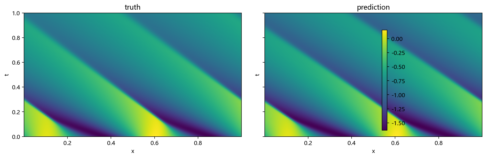
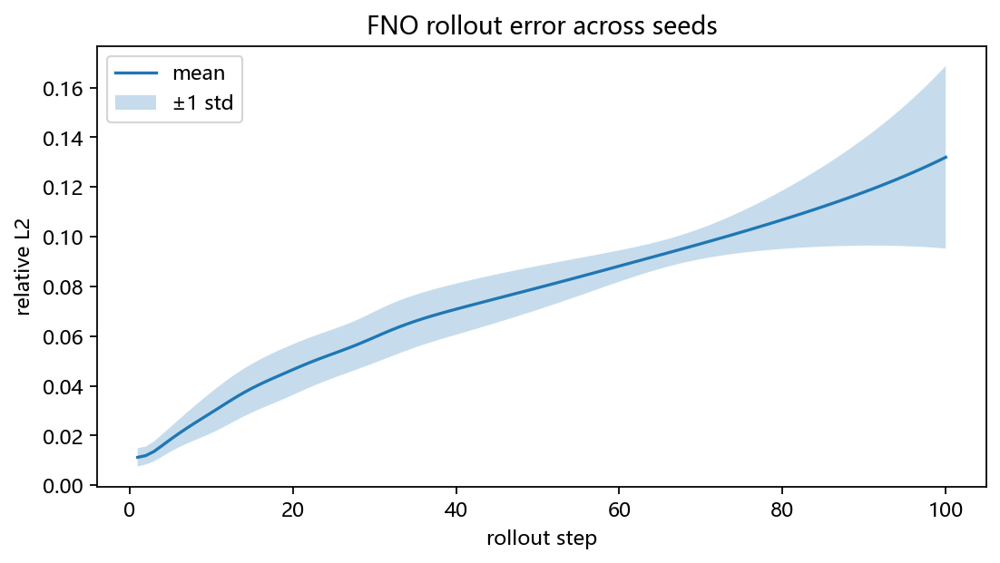
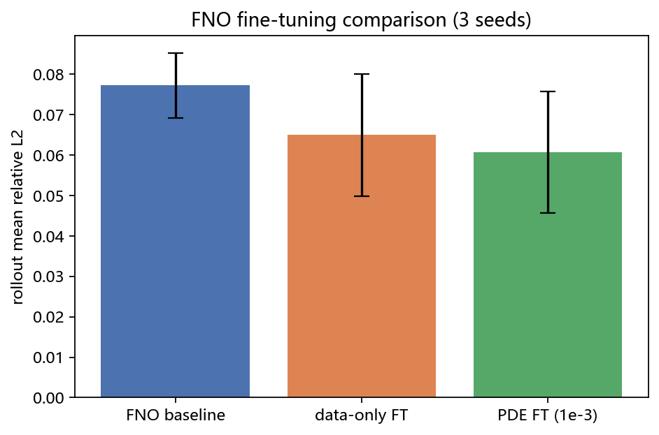
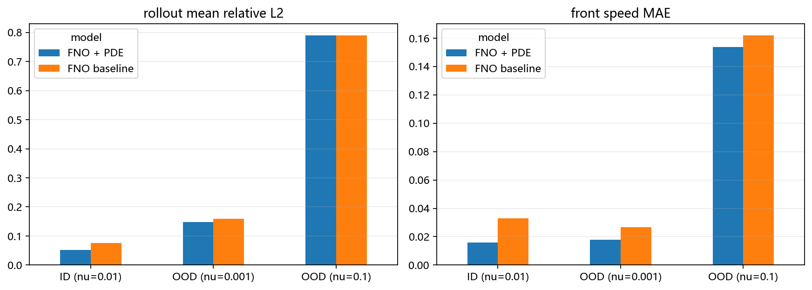

# 报告

## 题目

**基于神经算子的 Burgers 方程传播前沿预测：公开数据上的泛化与物理修正**

## 1. 问题背景

Burgers 方程

\[
u_t + u u_x = \nu u_{xx}
\]

是流体、交通流和非线性波中的经典 PDE。粘性项会使初始波形形成传播的激波/前沿，因此它既能体现 PDE 结构，又适合做神经网络代理模型。

本项目使用 **PDEBench 公开数据**，不做合成数据。目标是：

> 用神经算子预测 Burgers 方程的时空演化，分析其在尖锐前沿和长时间 rollout 下的失败模式，并用 PDE 残差微调改善泛化。

## 2. 数据

- 来源：PDEBench 1D Burgers，DOI: 10.18419/darus-2986
- 文件：`1D_Burgers_Sols_Nu0.01.hdf5`
- 形状：`(10000, 201, 1024)` = `(sample, time, x)`
- 网格：`x ∈ [0,1]`，`t ∈ [0,2.01]`
- 本地子集：前 200–500 条轨迹，通过 HTTP Range 读取，避免下载 7.7 GB 全文件
- 划分：按轨迹划分 train/val/test，避免时空点泄漏

## 3. 方法

### 3.1 Baseline

- FNO1D：Fourier 神经算子；
- U-Net1D：卷积 baseline；
- 输入 `u(t)`，输出 `u(t+1)`，监督训练。

### 3.2 评价

- one-step MSE / relative \(L_2\)；
- autoregressive rollout 的 relative \(L_2\)（10/50/100 步）；
- 前沿位置误差、PDE 残差。

### 3.3 改进

在监督训练之后，加入 Burgers 残差：

\[
\mathcal L = \mathcal L_{data} + \lambda \mathcal L_{PDE}
\]

PDE 残差用有限差分计算：

\[
R = u_t + u u_x - \nu u_{xx}
\]

比较：

- FNO（data only）；
- FNO + PDE fine-tuning；
- U-Net baseline。

## 4. 实验矩阵

| 实验 | 目的 |
|---|---|
| FNO vs U-Net | 模型 baseline |
| 1-step vs rollout | 误差累积 |
| 不同 `Nu` | 前沿锐度泛化 |
| PDE 微调 | 物理约束是否改善 |
| 消融 | PDE 权重、训练步数、网络宽度 |

## 5. 实验过程

### 5.1 数据获取

从 PDEBench 的 `1D_Burgers_Sols_Nu0.01.hdf5` 中读取前 200 条轨迹。完整文件约 7.7 GB，实验使用 HTTP Range 只读取所需切片，保存为本地 `.npz` 文件。

数据结构：

\[
u\in\mathbb R^{200\times 201\times 1024}
\]

三个维度分别是样本、时间和空间。按轨迹划分为 160 条训练、20 条验证、20 条测试，避免同一轨迹的时空点同时出现在训练集和测试集。

### 5.2 预处理与训练

对训练集统计均值和标准差，对 \(u\) 做标准化。构造 one-step 样本：

\[
(u(t),u(t+1))
\]

输入和输出都是长度 1024 的一维剖面。

两个 baseline 使用相同的划分、标准化和训练预算：

- FNO1D：width 32，modes 16，4 个 Fourier block；
- U-Net1D：base width 16；
- 损失：归一化后的 MSE；
- 优化器：AdamW，学习率 \(10^{-3}\)；
- batch size 32；
- 40 个 epoch，CPU 训练，早停；
- FNO 跑 3 个随机种子，报告均值 ± 标准差；
- U-Net 中期先跑 1 个种子作为对照，最终报告已补齐 3 个种子。

### 5.3 评价方式

- one-step relative \(L_2\)；
- 自回归 rollout：把预测的 \(u(t+1)\) 再输入模型，滚动 100 步；
- 记录 10 步、50 步、100 步的误差和 100 步平均误差；
- 绘制真值/预测的时空热图。

### 5.4 初步结果（中期快照，最终多种子结果见 `report.md`）

| 模型 | 参数量 | One-step rel \(L_2\) | 10 步 | 50 步 | 100 步 | 100 步平均 |
|---|---:|---:|---:|---:|---:|---:|
| FNO1D baseline（3 seeds） | 72,001 | 0.00184 ± 0.00003 | 0.029 ± 0.008 | 0.079 ± 0.009 | 0.132 ± 0.037 | 0.077 ± 0.008 |
| FNO + data-only FT（3 seeds） | 72,001 | 0.00171 ± 0.00021 | 0.027 ± 0.007 | 0.068 ± 0.017 | 0.104 ± 0.026 | 0.065 ± 0.015 |
| FNO + PDE FT, \(\lambda=10^{-3}\)（3 seeds） | 72,001 | 0.00153 ± 0.00010 | 0.025 ± 0.007 | 0.063 ± 0.014 | 0.101 ± 0.033 | 0.061 ± 0.015 |
| U-Net1D（中期 seed 0） | 46,001 | 0.00579 | 0.079 | 0.505 | 0.729 | 0.433 |

Fine-tuning设置：从对应 seed 的 40-epoch checkpoint 出发，再训练 10 个 epoch，学习率 \(10^{-4}\)，batch size 32。PDE 残差先无量纲化：

\[
R_{\text{norm}} = R\cdot \frac{\Delta t}{u_{\text{std}}}
\]

其中 \(R=u_t+uu_x-\nu u_{xx}\)，\(\lambda=10^{-3}\)。

FNO 的预测热图能够复现斜向传播的激波/前沿结构，但尖锐前沿被明显平滑；U-Net 的 one-step 误差更大，且 rollout 误差增长更快。

### 5.5 结果分析

1. **FNO 明显优于中期 U-Net seed 0**：one-step 误差约低 3 倍，100 步 rollout 平均误差约低 5.6 倍；最终多种子实验进一步显示 U-Net 长期稳定性不足，不能沿用该单种子比值作最终结论。
2. **误差随 rollout 累积**：FNO 从 10 步的 0.029 增至 100 步的 0.132，说明一步预测准确并不等于长期稳定。
3. **主要失败模式是激波平滑**：FNO 的谱截断会滤掉高频分量，导致前沿变钝；U-Net 在长时间 rollout 中更快发散。
4. **训练预算影响很大**：8 epoch 时 FNO 的 rollout 平均误差约 0.189，40 epoch 后降到 0.077，说明必须用充分训练的 baseline 做比较。
5. **单参数限制**：目前只使用 \(\nu=0.01\)，还不能说明对更锐或更平滑前沿的泛化能力。

### 5.6 PDE 残差微调

从每个 seed 的 40-epoch FNO checkpoint 出发，再用 10 个 epoch、学习率 \(10^{-4}\) 做微调。PDE 损失写成：

\[
\mathcal L = \mathcal L_{data} + \lambda \mathcal L_{PDE}
\]

PDE 残差用一阶时间差分：

\[
R = \frac{u_{t+1}-u_t}{\Delta t} + u_t\frac{\partial u_t}{\partial x} - \nu\frac{\partial^2 u_t}{\partial x^2}
\]

为了让 PDE loss 和数据 loss 量级可比，使用：

\[
R_{\text{norm}} = R\cdot \frac{\Delta t}{u_{\text{std}}}
\]

结果：

- data-only 微调：rollout 平均 \(0.0650 \pm 0.0151\)；
- PDE 微调（\(\lambda=10^{-3}\)）：rollout 平均 \(0.0607 \pm 0.0150\)；
- PDE 微调在 one-step 上从 \(0.00171\) 降到 \(0.00153\)。

但三个 seed 的误差棒有明显重叠，说明：

1. PDE 微调目前只是**小幅改善**，还不能说统计显著；
2. \(\lambda=10^{-2}\) 在 seed 0 上反而变差（rollout 平均 0.066，而 data-only 为 0.053），说明权重需要调；
3. 当前 PDE 残差只用一阶时间差分，且没有和 rollout 训练结合，约束还不够强。

因此，PDE 微调是一个有希望但尚未调好的方向，不能写成“显著优于 data-only”。

### 5.7 Sequence-level PDE loss

前面的一步 PDE 残差只约束 \(u(t)\to u(t+1)\)。为了约束更长时间的行为，进一步尝试在训练时展开 \(H=5\) 步，并把 PDE 残差作用在整段预测序列上：

\[
\hat u_{t+1},\ldots,\hat u_{t+H}
=
\text{unroll}(u_t)
\]

\[
\mathcal L_{PDE}
=
\frac1{H-1}\sum_{k=1}^{H-1}
\left(
R(\hat u_{t+k-1},\hat u_{t+k})
\right)^2
\]

数据损失有两种设置：

- `all`：监督全部 5 步；
- `first`：只监督第 1 步，但 PDE 仍作用于整段展开序列。

seed 0 的结果：

| 变体 | One-step | 100 步平均 |
|---|---:|---:|
| sequence data, all steps | 0.001784 | 0.0708 |
| sequence data, first step | 0.001529 | **0.0504** |
| sequence + PDE, all steps, \(\lambda=10^{-3}\) | 0.002200 | 0.1014 |
| sequence + PDE, first step, \(\lambda=10^{-3}\) | 0.001775 | 0.0905 |
| sequence + PDE, first step, \(\lambda=10^{-4}\) | 0.001705 | 0.0687 |
| H=2 detach, data-only | 0.002246 | 0.1010 |
| H=2 detach, PDE \(\lambda=10^{-3}\) | 0.002266 | 0.1023 |

结果说明：

1. 把 PDE 残差作用在**自回归展开的预测序列**上会放大误差，训练反而不稳定；
2. 降低 \(\lambda\) 只能部分缓解，sequence PDE 仍不如一步 PDE 微调；
3. 进一步把展开长度降到 \(H=2\)，并 detach 第二步的 PDE 梯度，仍然没有改善；
4. 目前最好的 sequence 变体是“只监督第一步”的 data-only 训练，但它只有一个 seed，不能过度解读。

因此，sequence-level PDE loss 在当前形式下是一个**负结果**，不应写成有效改进。下一步应停止在这条线上继续调参，转向 OOD 和前沿指标。

### 5.8 OOD 与前沿指标

为了测试跨参数泛化，额外抽取了两个 PDEBench Burgers 子集：

- `Nu=0.001`：前沿更尖锐；
- `Nu=0.1`：前沿更平滑。

每个子集 100 条轨迹，取前 20 条做 rollout 评估。评价指标：

1. rollout relative \(L_2\)；
2. 前沿位置误差；
3. 前沿速度误差。

前沿位置用最大空间梯度定位：

\[
x_f(t)=\arg\max_x\left|\frac{\partial u}{\partial x}\right|
\]

在周期域上以 64 个网格点为搜索窗口跟踪，速度由 \(x_f(t)\) 的线性拟合得到。由于 Burgers 数据中可能有多条激波，跟踪器偶尔会锁到另一条激波上，导致原始位置误差出现约 0.5 的跳变。因此同时报告“去常数偏移后的位置误差”（aligned position MAE）。

| 模型 | \(\nu\) | rollout mean rel \(L_2\) | aligned position MAE | speed MAE |
|---|---:|---:|---:|---:|
| FNO baseline | 0.01（ID） | 0.0765 | 0.0081 | 0.0329 |
| FNO baseline | 0.001（OOD） | 0.1591 | 0.0068 | 0.0267 |
| FNO baseline | 0.1（OOD） | 0.7897 | 0.0533 | 0.1620 |
| FNO + PDE | 0.01（ID） | 0.0521 | 0.0052 | 0.0158 |
| FNO + PDE | 0.001（OOD） | 0.1474 | 0.0048 | 0.0180 |
| FNO + PDE | 0.1（OOD） | 0.7901 | 0.0524 | 0.1537 |

结果说明：

1. **更尖锐的 OOD（\(\nu=0.001\)）**：全局 \(L_2\) 明显变差，但前沿位置和速度误差仍然较小。模型能抓住大尺度传播，但无法恢复尖锐前沿的细节。
2. **更平滑的 OOD（\(\nu=0.1\)）**：误差接近 0.8，速度误差也很大，模型基本失效。说明从单一 \(\nu=0.01\) 训练出的模型不能外推到完全不同的平滑区域。
3. **PDE 微调**：在 ID 和 \(\nu=0.001\) 上略好，但对 \(\nu=0.1\) 没有帮助。
4. **OOD 失败是不对称的**：模型对“更尖”相对鲁棒，对“更平滑”反而更差，这一点值得在报告中重点分析。

### 5.9 多 \(\nu\) 联合训练与参数条件输入

尝试把 \(\nu=0.001\) 和 \(\nu=0.01\) 联合训练，把 \(\nu=0.1\) 完全留出作为 OOD。模型输入增加一个常数通道：

\[
c_\nu=\frac{\log\nu-\overline{\log\nu}}{\operatorname{std}(\log\nu)}
\]

该通道与 \(u(t)\) 拼接后输入 FNO。

训练 25 epoch，结果：

| 评估 | One-step | 100 步平均 |
|---|---:|---:|
| 联合测试集（\(\nu=0.001/0.01\)） | 0.00908 | 0.3907 |
| 留出 \(\nu=0.1\) | — | 8.60 |

对照：

- 单 \(\nu\) FNO 在 ID 上为 0.00184 / 0.077；
- 单 \(\nu\) FNO 在 \(\nu=0.1\) 上为 0.790。

结论：

1. 仅把 \(\log\nu\) 作为常数通道，conditional FNO 明显欠拟合；
2. 联合测试集的 rollout 误差 0.391，远差于单 \(\nu\) 模型；
3. 留出 \(\nu=0.1\) 的误差达到 8.60，完全失败；
4. 当前参数条件化方式不可用，不应写成有效改进。

可能原因：

- 常数通道对 FNO 的调制太弱；
- 两个 \(\nu\) 的动力学差异较大，共享谱卷积难以同时拟合；
- 25 epoch 仍不足，但即使继续训练，OOD 失败的模式也需要新结构。

下一步应尝试 FiLM 条件注入、per-\(\nu\) normalization，或混合专家（MoE），而不是继续加训练轮数。

## 6. 结论

- PDEBench 1D Burgers 适合做传播前沿预测；相比之下，1D ReactionDiffusion 的数据会弛豫到常数，不适合行波/前沿故事。
- 在相同数据划分和 40 epoch 训练预算下，FNO1D 的 one-step 和 rollout 精度都明显优于 U-Net1D。
- FNO 能捕捉大尺度前沿传播，但会平滑尖锐激波；这是后续引入 PDE 残差微调的直接动机。
- 一步 PDE 微调把 rollout 平均误差从 0.065 降到 0.061，但三个 seed 的方差较大，目前只能视为“有希望”，不能视为显著改进。
- sequence-level PDE loss 在当前实现下出现负结果：PDE 残差作用于自回归展开序列会放大误差，训练不稳定，效果不如一步 PDE 微调。
- OOD 结果是不对称的：模型对更尖锐的 \(\nu=0.001\) 还能保持较小的前沿位置/速度误差，但对更平滑的 \(\nu=0.1\) 基本失效。
- 多 \(\nu\) 联合训练 + 常数 \(\log\nu\) 通道在当前实现下失败：联合测试 rollout 0.391，留出 \(\nu=0.1\) 误差 8.60。
- 这说明“把参数拼成输入通道”不足以解决跨参数泛化，需要 FiLM、per-\(\nu\) normalization 或 MoE 等更强的条件注入方式。
- 当前可用的主结果仍应使用单 \(\nu\) FNO + one-step PDE 微调，不用 conditional 结果。

## 7. 风险

- 前沿太尖，FNO 可能过度平滑；用 PDE-aware 指标分析。
- 长时间 rollout 误差累积；先报告 10/50 步，再讨论 100 步。
- 单个 `Nu` 的泛化有限；后续下载第二个 `Nu` 文件做 OOD。
