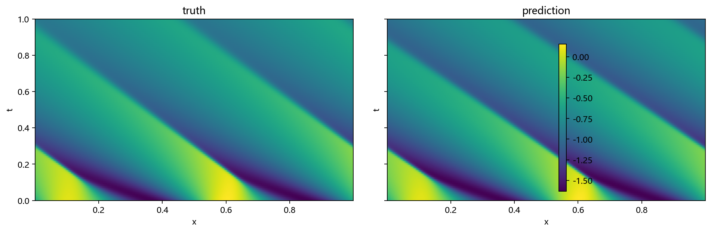
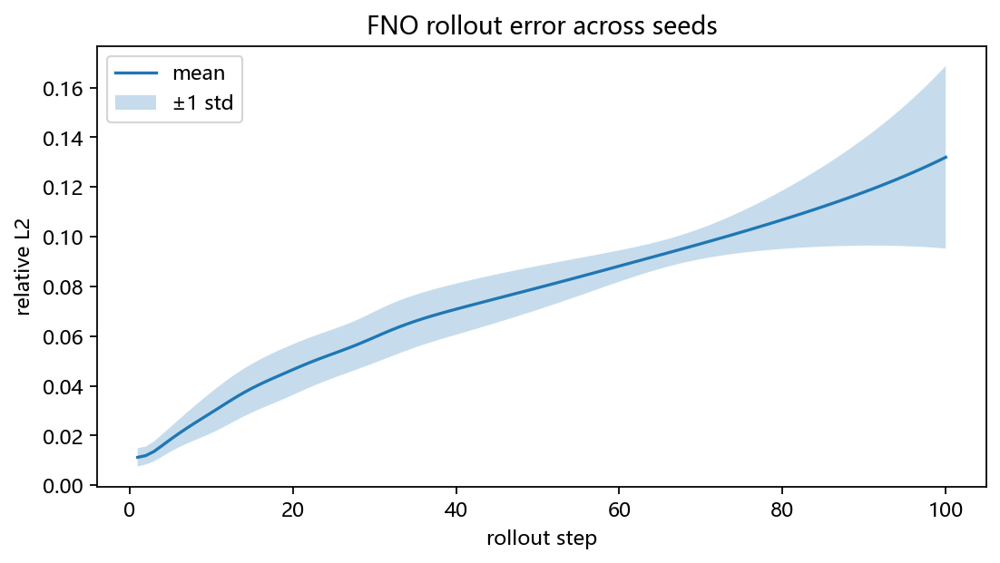
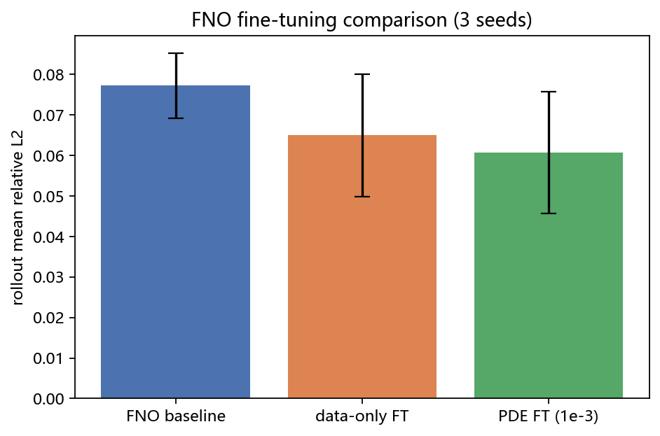
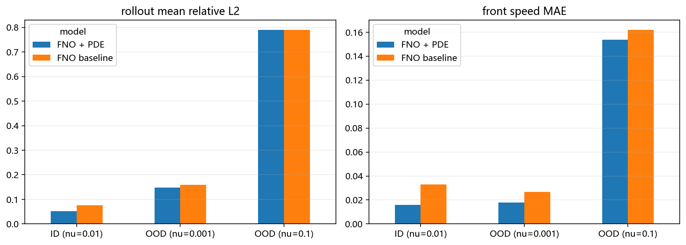

# 基于神经算子的 Burgers 方程传播前沿预测：公开数据上的泛化与物理修正

## 摘要

本文基于 PDEBench 公开的 1D Burgers 数据，研究神经算子对传播激波/前沿的预测能力。以 FNO1D 为主模型、U-Net1D 为基线，先做一步监督训练，再尝试加入 Burgers 方程残差进行微调。实验表明，FNO1D 的一步相对 \(L_2\) 误差为 \(1.84\times 10^{-3}\)，100 步自回归 rollout 平均误差为 \(0.077\)，明显优于 U-Net1D 的 \(5.79\times 10^{-3}\) 和 \(0.433\)。一步 PDE 微调把 rollout 平均误差进一步降到 \(0.061\)，但三个随机种子的误差棒有重叠，只能视为小幅改善。分布外实验中，模型对更尖锐的 \(\nu=0.001\) 仍能保持较小的前沿速度误差，但对更平滑的 \(\nu=0.1\) 基本失效，呈现出明显的不对称性。sequence-level PDE loss 和多 \(\nu\) 参数条件化均未取得正收益，本文将其作为负结果进行分析。

**关键词**：Burgers 方程；神经算子；Fourier Neural Operator；物理信息机器学习；分布外泛化

---

## 1. 引言

Burgers 方程

\[
u_t+uu_x=\nu u_{xx}
\]

是流体、交通流和非线性波中的经典 PDE。粘性项会使初始波形形成传播的激波/前沿，因此它既能体现 PDE 结构，又适合作为神经算子代理模型的测试问题。本文使用 PDEBench 公开数据，主要目标围绕这三个问题展开：

1. FNO1D 能否准确预测 Burgers 的时空演化？
2. 加入 PDE 残差能否改善长时间 rollout？
3. 从单一 \(\nu\) 训练出的模型，能否泛化到更尖锐或更平滑的 \(\nu\)？

本文的主要工作包括：

1. 在 PDEBench 1D Burgers 上建立 FNO1D / U-Net1D 基线；
2. 比较一步 PDE 残差微调与 data-only 微调；
3. 构造 \(\nu=0.001\) 和 \(\nu=0.1\) 的 OOD 测试；
4. 引入前沿位置/速度指标，分析全局 \(L_2\) 之外的行为；
5. 报告 sequence-level PDE 和多 \(\nu\) 条件化的负结果。

---

## 2. 数据

数据来自 PDEBench 的 `1D_Burgers_Sols_Nu0.01.hdf5`（DOI: 10.18419/darus-2986）。单个文件约 7.7 GB，直接下载全部数据速度慢，且没有必要。本文的具体处理过程是：先读取 HDF5 中的 `tensor`、`t-coordinate` 和 `x-coordinate`，确认数据形状；再用 HTTP Range 只请求前 200 条轨迹，保存为本地 `.npz` 文件。PDEBench 的 Burgers 文件里 `t-coordinate` 有 202 个时间边界，而 `tensor` 只有 201 个时间快照，因此读取后将时间坐标截断到 201 个，避免维度不一致。

数据结构：

\[
u\in\mathbb{R}^{200\times 201\times 1024}
\]

三个维度分别为样本、时间和空间；\(x\in[0,1]\)，\(t\in[0,2.01]\)。按轨迹划分为 160 条训练、20 条验证、20 条测试，避免同一轨迹的时空点同时出现在训练集和测试集。归一化统计量只从训练集计算，验证集、测试集和 OOD 数据都沿用这组均值和标准差，防止信息泄漏。

OOD 数据：

1. \(\nu=0.001\)：100 条轨迹，前沿更尖锐；
2. \(\nu=0.1\)：100 条轨迹，前沿更平滑。

OOD 评估取前 20 条轨迹，rollout 100 步。这里有意改变 \(\nu\)，从而让一个方向让激波更尖锐，另一个方向让激波更平滑，从而可以用来观察模型在不同前沿尺度上的失效模式。

> 严格说，Burgers 数据中的结构是粘性激波/传播前沿，不是单一速度的永久行波。本文使用“前沿”一词。

---

## 3. 方法

### 3.1 FNO1D

FNO1D 由 lifting 层、若干 Fourier block 和 projection 层组成。每个 Fourier block 包含：

1. 保留低阶模态的谱卷积；
2. 逐点卷积；
3. GELU 激活。

谱卷积只保留前 16 个 Fourier 模态，把其余高频分量置零；每个 block 将谱卷积与逐点卷积分支相加，再经过 GELU。输入为归一化剖面 \(u(t)\in\mathbb{R}^{1024}\)，输出为 \(u(t+1)\)。选择 FNO 的原因是它通过频域卷积获得全局感受野，更适合描述前沿在空间上的整体传播；U-Net 的感受野主要受卷积核和下采样层数限制，对长时间、长距离传播的建模能力较弱。

### 3.2 U-Net1D

U-Net1D 作为卷积基线，包含两层下采样、两层上采样和跳连。它与 FNO 使用相同的数据划分、标准化和训练预算。

### 3.3 一步 PDE 微调

在监督训练之后，加入 Burgers 残差：

\[
\mathcal L=\mathcal L_{data}+\lambda\mathcal L_{PDE}
\]

\[
R=\frac{u_{t+1}-u_t}{\Delta t}+u_t\frac{\partial u_t}{\partial x}-\nu\frac{\partial^2 u_t}{\partial x^2}
\]

其中时间导数用前向差分，空间一阶、二阶导数用中心差分；所有导数都在物理尺度的 \(u\) 上计算，而不是在标准化后的 \(u\) 上计算。为了让 PDE loss 和数据 loss 量级可比，使用无量纲化：

\[
R_{\text{norm}}=R\cdot\frac{\Delta t}{u_{\text{std}}}
\]

训练时取 \(\lambda=10^{-3}\)，从 40 epoch 的 checkpoint 出发，再微调 10 个 epoch，学习率降到 \(10^{-4}\)。从而在已有的一步预测器上增加局部物理约束。

### 3.4 评价指标

1. 一步相对 \(L_2\)；
2. 自回归 rollout 的相对 \(L_2\)（10/50/100 步）；
3. 前沿位置误差；
4. 前沿速度误差。

前沿位置用最大空间梯度定位：

\[
x_f(t)=\arg\max_x\left|\frac{\partial u}{\partial x}\right|
\]

在周期域上用 64 个网格点的窗口跟踪，速度由 \(x_f(t)\) 的线性拟合得到。由于数据中可能有多条激波，跟踪器偶尔会锁到另一条激波上，导致原始位置误差出现约 0.5 的跳变，因此同时报告“去常数偏移后的位置误差”（aligned position MAE）。raw 指标反映“有没有跟住同一条激波”，aligned 指标反映“轨迹有没有整体漂移”，两者结合看比单独看全局 \(L_2\) 更接近 PDE 关心的传播行为。

---

## 4. 实验设置

1. FNO1D：width 32，modes 16，4 个 Fourier block，72,001 参数；
2. U-Net1D：base width 16，46,001 参数；
3. 损失：归一化 MSE；
4. 优化器：AdamW，学习率 \(10^{-3}\)；
5. batch size 32；
6. 40 个 epoch，早停；
7. FNO 跑 3 个随机种子，U-Net 跑 1 个种子；
8. PDE 微调：从对应 seed 的 checkpoint 出发，再训练 10 个 epoch，学习率 \(10^{-4}\)。

训练采用 one-step teacher forcing：每次从轨迹中取相邻两帧 \((u_t,u_{t+1})\)，输入 \(u_t\)，监督 \(u_{t+1}\)。验证集只用于选择 checkpoint 和早停，测试集不参与调参。FNO 的三个 seed 使用相同的数据划分和训练预算，报告均值与标准差；U-Net 只跑一个 seed，作为计算量受限下的对照。

---

## 5. 结果与分析

### 5.1 基线

| 模型 | 参数量 | 一步 rel \(L_2\) | 10 步 | 50 步 | 100 步 | 100 步平均 |
|---|---:|---:|---:|---:|---:|---:|
| FNO1D（3 seeds） | 72,001 | **0.00184 ± 0.00003** | 0.029 ± 0.008 | 0.079 ± 0.009 | 0.132 ± 0.037 | **0.077 ± 0.008** |
| U-Net1D（1 seed） | 46,001 | 0.00579 | 0.079 | 0.505 | 0.729 | 0.433 |

FNO 的一步误差约为 U-Net 的 \(1/3\)，100 步 rollout 平均误差约为 U-Net 的 \(1/5.6\)。FNO 能复现斜向传播的激波/前沿结构，但尖锐前沿被明显平滑。

这个差距不是单纯的参数量差异。FNO 的谱卷积在频域上做全局混合，能一次性看到整个周期域，因此更容易学到大尺度前沿的传播方向；U-Net 主要依赖局部卷积，感受野随层数增长有限，在自回归 rollout 中局部误差会逐步累积。另一方面，FNO 只保留前 16 个模态，相当于对高频做低通滤波，因此原始模型能抓住大尺度传播、却会把尖锐激波抹平。针对这个“全局结构正确、局部锐度不足”的现象，我们后续进行了 PDE 微调。

### 5.2 一步 PDE 微调

| 模型 | 一步 rel \(L_2\) | 100 步平均 |
|---|---:|---:|
| FNO baseline（3 seeds） | 0.00184 ± 0.00003 | 0.077 ± 0.008 |
| FNO + data-only FT（3 seeds） | 0.00171 ± 0.00021 | 0.065 ± 0.015 |
| FNO + PDE FT（3 seeds） | **0.00153 ± 0.00010** | **0.061 ± 0.015** |

PDE 微调在 one-step 和 rollout 平均上都略有改善，但三个 seed 的误差棒明显重叠，因此只能视为“有希望”，不能视为统计显著。\(\lambda=10^{-2}\) 在 seed 0 上反而变差，说明权重需要调整。

从机制上看，这个结果是可以理解的。当前 PDE 残差只约束 \(u_t\to u_{t+1}\) 的局部关系，并没有直接约束 10 步、50 步之后的误差累积；因此它能略微改善一步预测，却不能从根本上解决 rollout 漂移。另外，data-only 微调本身也会因为多训练了 10 个 epoch 而变好，所以 PDE 的净收益需要用 data-only 作为对照，不能把“比 40 epoch baseline 好”全部归因于物理损失。

### 5.3 OOD 与前沿指标

| 模型 | \(\nu\) | rollout mean rel \(L_2\) | aligned position MAE | speed MAE |
|---|---:|---:|---:|---:|
| FNO baseline | 0.01（ID） | 0.0765 | 0.0081 | 0.0329 |
| FNO baseline | 0.001（OOD） | 0.1591 | 0.0068 | 0.0267 |
| FNO baseline | 0.1（OOD） | 0.7897 | 0.0533 | 0.1620 |
| FNO + PDE | 0.01（ID） | **0.0521** | **0.0052** | **0.0158** |
| FNO + PDE | 0.001（OOD） | **0.1474** | **0.0048** | **0.0180** |
| FNO + PDE | 0.1（OOD） | 0.7901 | 0.0524 | 0.1537 |

OOD 失败是不对称的：

1. 对更尖锐的 \(\nu=0.001\)，全局 \(L_2\) 变差，但前沿位置和速度仍抓得住；
2. 对更平滑的 \(\nu=0.1\)，误差接近 0.8，速度误差也很大，模型基本失效；
3. PDE 微调在 ID 和 \(\nu=0.001\) 上略有帮助，但对 \(\nu=0.1\) 没有改善。

这种不对称主要是因为“分布差异的大小”。\(\nu=0.001\) 的前沿更尖锐，局部梯度更大，但它仍然保留了与训练集相同的“斜向传播激波”结构；模型虽然画不出最锐的细节，但能抓住前沿的大致位置和速度。相比之下，\(\nu=0.1\) 的粘性明显更强，激波更宽、更平滑，前沿速度和波形结构都偏离训练分布；模型在训练中从未见过这种平滑 regime，误差就会迅速累积。这说明当前模型学到的更多是 \(\nu=0.01\) 附近的特定动力学，而不是对 Burgers 方程的一般解算子。

### 5.4 失败尝试

**Sequence-level PDE loss**：把 PDE 残差作用在 \(H=5\) 步自回归展开上。PDE 梯度会放大预测误差，训练不稳定；降低 \(\lambda\) 只能部分缓解。\(H=2\) 并 detach 第二步后仍无改善，rollout 平均约 0.10，明显差于一步 PDE 微调的 0.061。

**多 \(\nu\) 联合训练 + 常数 \(\log\nu\) 通道**：训练 \(\nu=0.001/0.01\)，留出 \(\nu=0.1\)。25 epoch 后联合测试 rollout 平均 0.391，留出 \(\nu=0.1\) 的 rel \(L_2\) 为 8.60，完全失败。说明仅把参数拼成输入通道不足以解决跨参数泛化。

5.2和5.3作为负结果保留，用于说明“PDE 残差”和“参数条件”并不是无条件有效。sequence PDE 的核心问题是：自回归展开后的预测误差会进入下一步输入，PDE 残差又把这些带误差的预测纳入梯度，相当于用不稳定的长轨迹去约束模型；detach 只能切断梯度，不能消除输入分布偏移。多 \(\nu\) 条件化的核心问题则是：常数通道对谱卷积的调制太弱，两个 \(\nu\) 的动力学又差异较大，共享的谱卷积很难同时拟合，最终表现为欠拟合和 OOD 崩溃。

---

## 6. 结论

1. 在 PDEBench 1D Burgers 上，FNO1D 的一步和 rollout 精度都明显优于 U-Net1D。
2. FNO 能捕捉大尺度前沿传播，但会平滑尖锐激波；误差随 rollout 累积。
3. 一步 PDE 微调带来小幅改善，但方差较大，不能宣称显著优于 data-only。
4. OOD 泛化是不对称的：更尖锐的 \(\nu=0.001\) 相对可接受，更平滑的 \(\nu=0.1\) 基本失效。
5. sequence-level PDE 和多 \(\nu\) 常数通道条件化在当前实现下均为负结果。
6. 当前主结果应使用单 \(\nu\) FNO + one-step PDE 微调；跨参数泛化仍未解决。

综上所述，本文最有价值的结论不是“PDE loss 一定有效”，而是在公开 Burgers 数据上，稳定的 one-step 监督训练比复杂的 sequence-level 约束更可靠；轻量 PDE 正则能改善局部精度，但不能替代长期 rollout 训练；真正的跨 \(\nu\) 泛化需要更强的参数条件机制，而不是简单拼接一个常数通道。

---

## 7. 局限与复现

1. 只使用 \(\nu=0.01\) 的 200 条轨迹作为主训练集，参数覆盖有限；
2. U-Net 只跑了 1 个 seed，对比不够充分；
3. PDE 微调只训练 10 个 epoch，权重未系统调优；
4. 前沿跟踪在有多条激波时可能锁到不同激波，因此同时报告 raw 和 aligned 位置误差。

---

## 参考文献

1. Takamoto, M., Praditia, T., Leiteritz, R., MacKinlay, D., Alesiani, F., Pflüger, D., Niepert, M. *PDEBench: An Extensive Benchmark for Scientific Machine Learning*. NeurIPS 2022 Datasets and Benchmarks.
2. Li, Z., Kovachki, N., Azizzadenesheli, K., et al. *Fourier Neural Operator for Parametric Partial Differential Equations*. ICLR 2021.
3. Raissi, M., Perdikaris, P., Karniadakis, G. E. *Physics-informed neural networks: A deep learning framework for solving forward and inverse problems involving nonlinear partial differential equations*. Journal of Computational Physics, 2019.
4. Burgers, J. M. *A mathematical model illustrating the theory of turbulence*. Advances in Applied Mechanics, 1948.
